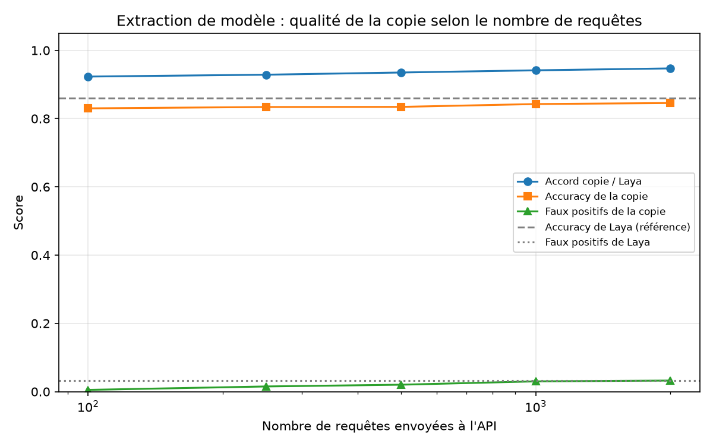
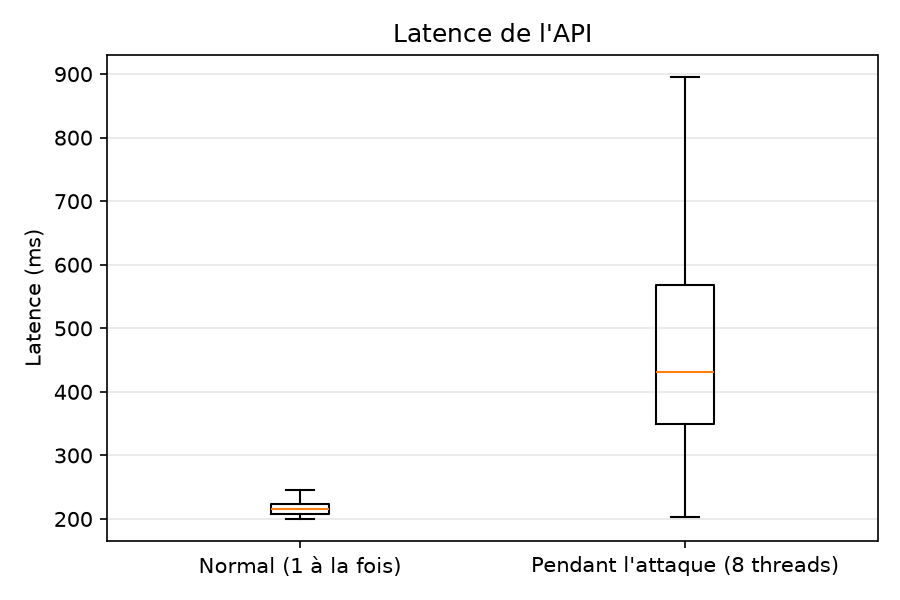

# Digital Social Score – TP2 : de la menace à la défense

Suite du [TP1](../TP1/README.md). On attaque l'API de détection de toxicité déployée sur GKE,
on mesure l'impact de l'attaque, puis on met en place une défense, la conformité IA Act et un
pipeline DevSecOps.

**Attaque choisie : extraction de modèle (model stealing).**

## Avancement

| Étape | Livrable | État |
|---|---|---|
| 1. Choix et analyse de l'attaque | fiche « Attaque IA » (1 page) | résumé ci-dessous, fiche à rédiger |
| 2. Mise en œuvre de l'attaque | script, graphiques, interprétation | ✅ |
| 3. Défense | tableau et graphique avant / après | à faire |
| 4. Conformité IA Act | fiche IA Act + `model_card.json` à la racine | à faire |
| 5. Intégration DevSecOps | pipeline sécurisé + logs d'exécution | à faire |

## Organisation

```
TP2/
├── attack/
│   └── attaque_extraction.py      étapes 2 et 3 : attaque par extraction de modèle
├── resultats/
│   ├── metrics.csv / metrics.json qualité de la copie par nombre de requêtes, latence
│   ├── extraction_metrics.png     graphique : copie vs Laya
│   ├── latence.png                graphique : latence normale vs pendant l'attaque
│   └── cache_reponses_api.json    réponses de l'API déjà obtenues (évite de les redemander)
├── requirements.txt               dépendances en plus de celles du TP1
├── TP2_Digital_Social_Score.pdf   énoncé
└── Cours_n°4 / n°5 (*.pdf)        supports de cours
```

## Installation

Depuis la racine du dépôt, dans l'environnement virtuel du TP1 :
```bash
pip install -r TP1/requirements.txt -r TP2/requirements.txt
```

---

## Étape 1 : analyse de l'attaque (résumé)

| Rubrique | Contenu |
|---|---|
| Type d'attaque | extraction de modèle (model stealing), en boîte noire |
| Cible | route `POST /score` de l'API (modèle Laya) |
| Point d'entrée | l'API elle-même : il suffit d'une clé API valide (client légitime ou clé volée) |
| Objectif de l'attaquant | obtenir une copie qui imite Laya sans les données ni le coût d'entraînement ; s'en servir hors ligne pour chercher les messages qui passent sous le seuil de détection |
| Impact technique | perte de propriété intellectuelle ; charge sur l'API (latence en hausse pour les autres clients) |
| Impact éthique | une copie permet de préparer des messages toxiques qui contournent la modération |
| Impact RGPD | le modèle a appris sur des messages de joueurs : une copie peut servir à des attaques d'inférence sur ces données |
| Risque IA Act | atteinte à la robustesse et à la cybersécurité du système (art. 15 pour les systèmes à haut risque) |

## Étape 2 : mise en œuvre de l'attaque

### Principe
L'attaquant n'a **que** l'accès à l'API :
1. il envoie des messages publics (GameTox, sans les labels) et récupère la décision `toxique` de l'API ;
2. il entraîne une copie (TF-IDF + régression logistique) sur ces réponses ;
3. on compare la copie à Laya sur le jeu d'évaluation (que l'attaquant n'a pas), pour
   100, 250, 500, 1 000 et 2 000 requêtes « volées » ;
4. on mesure la latence de l'API au calme puis pendant l'attaque (8 requêtes en parallèle).

### Lancement (depuis la racine du dépôt)
```powershell
$env:API_URL="http://<EXTERNAL-IP>/score" ; $env:API_KEY="<clé-API>"
python TP2/attack/attaque_extraction.py
```
L'URL et la clé passent **uniquement** par des variables d'environnement (jamais dans le code).
Le script réessaie avec une attente croissante si l'API répond 429/503 : il imite un attaquant
« patient » face à une limite de débit.

### Résultats (API déployée sur GKE, 2 pods)

| Requêtes volées | Accord copie / Laya | Accuracy copie | Précision copie | Faux positifs copie |
|---|---|---|---|---|
| 100 | 92,3 % | 83,0 % | 86,1 % | 0,5 % |
| 250 | 92,9 % | 83,4 % | 75,5 % | 1,5 % |
| 500 | 93,5 % | 83,4 % | 72,0 % | 2,0 % |
| 1 000 | 94,2 % | 84,3 % | 70,6 % | 3,0 % |
| 2 000 | 94,7 % | 84,6 % | 70,7 % | 3,2 % |
| **Laya (référence)** | – | **85,9 %** | **74,5 %** | **3,3 %** |

| Latence | Moyenne | P95 |
|---|---|---|
| Normale (1 requête à la fois) | 245 ms | 289 ms |
| Pendant l'attaque (8 threads) | 473 ms | 795 ms |




### Interprétation
- **L'attaque est très efficace et peu coûteuse.** Avec 100 requêtes, la copie prend déjà la
  même décision que Laya dans 92 % des cas. Avec 2 000 requêtes (quelques minutes), elle atteint
  94,7 % d'accord et une accuracy à 1,3 point de Laya, pour un modèle bien plus simple.
- **La copie reproduit aussi les erreurs de Laya.** Son taux de faux positifs monte de 0,5 % à
  3,2 %, presque celui de Laya (3,3 %) : elle n'apprend pas la vérité, elle apprend la frontière
  de décision de Laya. C'est exactement ce que cherche l'attaquant.
- **L'attaque dégrade le service pour les autres clients.** La latence moyenne double et la P95
  est multipliée par 2,75 : rien dans l'API ne limite le débit d'une même clé.
- **L'attaque passe inaperçue côté authentification** : toutes les requêtes portent une clé valide
  et sont des textes normaux. Seul le volume par clé (visible dans les journaux pseudonymisés et
  dans Grafana) la trahit.

## Étape 3 : défense

À faire : implémenter la défense dans `TP1/Deployment/api.py`, puis relancer l'attaque
**avec une étiquette**, pour ne pas écraser les résultats initiaux ni réutiliser leur cache :
```powershell
$env:ETIQUETTE="apres_defense"
python TP2/attack/attaque_extraction.py
```
Le script écrit alors `metrics_apres_defense.csv/.json`, `extraction_metrics_apres_defense.png`,
`latence_apres_defense.png`, et un cache séparé, vide au départ : l'attaque interroge vraiment
l'API protégée. Le JSON indique aussi le nombre et le taux de requêtes bloquées
(`attaque.requetes_bloquees`, `attaque.taux_blocage`).

## Étape 4 : conformité IA Act

À faire : fiche IA Act (catégorie de risque et justification) et `model_card.json` à la racine
du dépôt.

## Étape 5 : intégration DevSecOps

À faire : ajouter des étapes de sécurité au pipeline (aujourd'hui,
[`TP1/Deployment/cloudbuild.yaml`](../TP1/Deployment/cloudbuild.yaml) ne fait que construire
l'image) et conserver les logs d'exécution.
